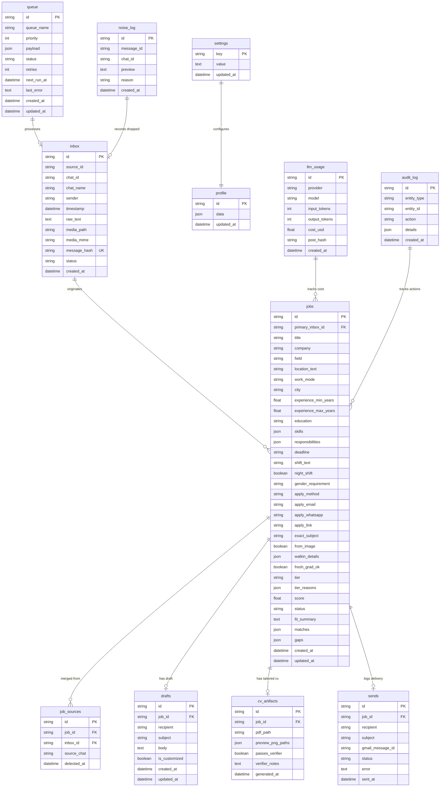

# Database Schema Specification (SQLite with WAL & FTS5)

## Overview
- Engine: SQLite 3 with Write-Ahead Logging (`PRAGMA journal_mode=WAL; PRAGMA foreign_keys=ON;`)
- Concurrency: Threaded connection pooling with SQLite WAL enabled.
- Location: `/app_data/db/apply.sqlite`
- Full-Text Search: SQLite FTS5 virtual table on jobs (`title`, `company`, `field`, `skills_text`, `location_text`).

## Entity Relationship Diagram


## Indexes
- `idx_jobs_tier_status`: `(tier, status, created_at DESC)`
- `idx_jobs_deadline`: `(deadline ASC)`
- `idx_jobs_company_title`: `(company, title)`
- `idx_inbox_hash`: `(message_hash)`
- `idx_queue_status_prio`: `(status, priority DESC, next_run_at ASC)`

## FTS5 Configuration
```sql
CREATE VIRTUAL TABLE jobs_fts USING fts5(
    job_id UNINDEXED,
    title,
    company,
    field,
    skills_text,
    location_text,
    content='jobs',
    content_rowid='rowid'
);
```
